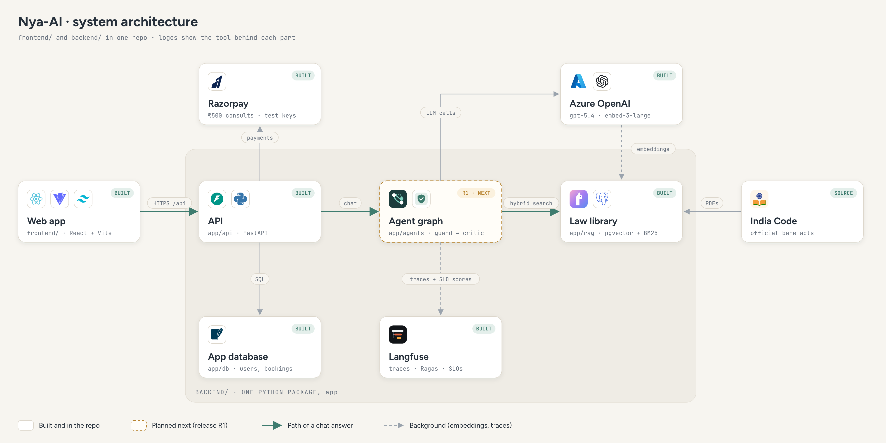

# Nya-AI

Nya-AI answers questions about Indian law from the law books themselves, cites the exact section
for every claim, and hands over to a verified advocate when a question needs real advice. Legal
information, not legal advice.

- **Design (Orbit UI, every screen on desktop and phone):** https://claude.ai/artifact/QYs5pGyrFcvACgYUWrUp1g
- **Agent plan (LangGraph, LlamaIndex, Langfuse):** https://claude.ai/artifact/KtuTmzcwCe2aMQqWRtVN29
- **Capstone design and golden queries:** [SubashNadar/legal-docs-platform](https://github.com/SubashNadar/legal-docs-platform), `docs/NYA-AI.md`

## Architecture



How a question is answered: [docs/diagrams/workflow.png](docs/diagrams/workflow.png) (SVG sources beside them).

## What runs today

| Part | Folder | Status |
| --- | --- | --- |
| Web app (React, Vite, TypeScript, Tailwind) | `frontend/` | Chat, advocates, booking, payment, lawyer portal |
| API (FastAPI, Python, uv) | `backend/app/api/` | Auth (OTP, JWT with logout), lawyers, bookings, Razorpay, messages |
| Chat answers | `backend/app/services/chat_engine.py` | Keyword rule engine as a fallback |
| Law library (LlamaIndex + pgvector + Langfuse) | `backend/app/rag/` | R0 built: ingest, hybrid search, golden check |
| Agents (LangGraph) | `backend/app/agents/` | R1, next: the graph that replaces `chat_engine.get_answer` |

## Run it locally

```bash
# API on http://localhost:8000
cd backend && uv sync && uv run uvicorn app.main:app --reload --port 8000

# Web app on http://localhost:5173
cd frontend && npm install && npm run dev
```

OTP login accepts any 4-digit code. The seeded advocate can sign in with phone `1234567890`.
Razorpay test keys go in `backend/.env` (see `backend/.env.example`); without them the payment
endpoints return `503` and everything else still works.

## Docs

- [`docs/DECISIONS.md`](docs/DECISIONS.md): product decisions the code depends on.
- [`docs/SLOS.md`](docs/SLOS.md): SLO definitions, targets and how they are tested.
- [`backend/README.md`](backend/README.md): backend layout, API, law library and tests.
- [`CLAUDE.md`](CLAUDE.md): working notes for Claude Code sessions.

## Rules

- Public legal sources only (India Code bare acts, government tables, public judgments). No
  publisher commentaries or textbooks.
- Never give advice on a user's own case; escalate to an advocate.
- Python is managed with **uv** only. No `pip`, `venv` or `requirements.txt`.
- No API keys in the repository.
